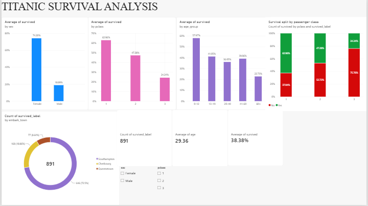

# Titanic Survival Analysis

## Objective
Analyze which factors (gender, passenger class, age) influenced survival on the Titanic and present the findings in an interactive dashboard.

## Dataset
Titanic dataset (891 passengers, 15 columns), loaded with Seaborn.

## Tools
Python (Pandas), Google Colab, Power BI

## Data Cleaning
- Dropped the `deck` column (mostly missing values)
- Filled missing `age` with the median
- Filled missing `embarked` and `embark_town` with the most common value
- Created `age_group` and `survived_label` columns

## Key Insights
- Overall survival rate was 38.4%.
- Women survived at about 74%, compared with about 19% for men.
- First-class passengers survived at about 63%, compared with about 24% in third class.
- Children aged 0-12 had the highest survival rate by age group (about 58%), and passengers over 60 had the lowest (about 23%).

## Dashboard

## Files
- `Titanic_Survival_analysis (1).ipynb`: cleaning and analysis
- `clean_titanic.csv`: cleaned data
- `titanic_dashboard.pbix`: Power BI dashboard
